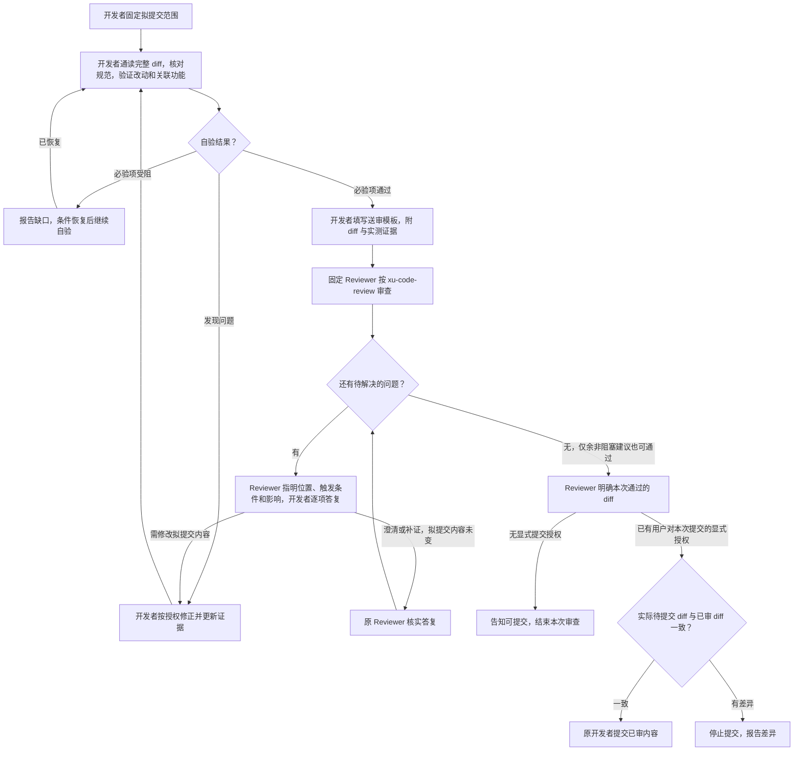

# xu-dev-review-loop

## 角色与职责

| 角色 | 谁来做 | 对什么负责 |
| --- | --- | --- |
| 开发者（`developer`） | 按下述规则绑定 | 修复、自审、自测、填写送审说明、逐项答复。获得用户显式提交授权后，由开发者核对并提交已审 diff。 |
| Reviewer（`code-reviewer`） | 与开发者使用独立上下文的固定审查者 | 只读审查拟提交的 diff，核实答复和证据，明确指出哪一份 diff 通过或仍有哪些问题。 |

- **单项目直接调用**：当前主 Agent 担任开发者。
- **多项目并行准备送审**：按项目各启动一个开发子 Agent，并行执行。模型按[分派、只读与台账契约](references/dispatch-and-ledger.md#多项目并行)选择。主 Agent 只负责统筹、分派、转交、核对交付和汇报，全程不兼任开发者。

同一 Bug 或新功能的两位经办者贯穿各轮。首次送审材料就绪后才分派 Reviewer，此后续接原会话。
其他工作流复用本技能时，可传入已绑定的开发者和 Reviewer。调用方负责分派和转交，保留双方的会话与审查记录。
仅需一次只读审查时，直接使用 `xu-code-review`。

## 协作流程

## 执行细则

### 自审、自测与送审范围

从已有改动开始，按 `xu-code-review` 固定需求或 Bug、目标路径、基线与拟提交的完整 diff。用 `codeSnapshot` 标识基线和实际差异内容，覆盖新增、删除、二进制内容及相关版本控制属性。对有未提交改动的工作副本，单独的提交号或 SVN 修订号不足以标识这份 diff。

开发者逐项核对实现、项目规范、无关改动和测试覆盖，按调用关系、配置或共享数据判断哪些已有功能可能受影响。在对应产物上验证本次改动和关联功能。自查或测试发现问题，先在授权范围内修正，再通读更新后的完整 diff，复查规范并复验受影响项；构建输入变化时先重建。必验项无法执行时记录原因、已尝试的方法和恢复条件，保留已取得的证据。

临时测试脚本、样例和夹具默认留在本地。送审材料记录复现步骤、输入、预期和实测结果，按需摘录输出。只有拟随产品提交的测试文件才纳入送审 diff。单独修改本地测试材料可在同一份 diff 上补证；若构建输入或实际验证对象发生变化，重新核对并取得对应产物的证据。

### 送审、澄清与复审

使用[开发者送审模板](references/review-submission.md)。Bug 修复和新功能使用相同字段。一次修改涉及多个 Bug 时，建议逐 Bug 填写，注明各自对应的改动和证据，可引用同一份送审 diff。

Reviewer 以送审 diff 为范围，按 `xu-code-review` 审查规范、需求、可靠性与安全，按需扩读调用方与上下文。问题应定位到文件、代码或具体差异，说明触发条件、预期与实际影响，能给出修正建议时一并给出。区分阻塞问题与非阻塞建议。Reviewer 核实开发者的澄清或补测证据后，可以直接关闭疑虑并通过原版本。

拟提交内容有变时，开发者重新自验，向原 Reviewer 提交新快照、完整拟提交 diff、相对上轮的增量、逐项答复和影响面。复审聚焦上轮问题、增量及其影响。继承已审部分的结论时记录未变且可解耦的依据；范围或设计整体变化时全量重审。白盒证据只在对应快照、构建及已验证范围内复用，黑盒 UT 与设备实测由 `xu-dev-ut-loop` 承接。

### 轮次、受阻与交接

- 正式审查或复审结论各计一轮。结论前的问答属于当轮，开发自验及工具调用失败不计轮。首次提交前审查默认上限 3 轮，可设 1–20 轮。换快照、换会话或恢复任务均沿用已计轮次。
- 达上限仍未通过、连续两轮同一阻塞无进展或阻塞数未减、单轮预计或实际超过 20–30 分钟时，报告进展、缺口与预计耗时，进入 `WAIT_USER` 由用户决定是否继续。缺修复授权或需裁决分歧时同样等待用户决定。
- 固定角色确实无法续接时，向同角色接手者移交快照、上轮结论、未结项、答复、证据与剩余轮次。独立角色不可用、关键证据缺失或运行版本意外漂移时进入 `BLOCKED`，报告恢复条件。Reviewer 只读隔离、身份与交接按[分派、只读与台账契约](references/dispatch-and-ledger.md)执行。
- 每次 UT 缺陷回流单独计轮，代码复审上限为 5 轮，调用方可指定更低上限。到上限仍有阻塞时进入 `WAIT_USER`，报告未结项并停止本次送审。实际轮次记入 `loops.defectReturn.history[n].codeReviewRounds`，首次审查及历次回流分别保留记录。
  收到已完成整轮的 UT 缺陷批次后，续接原开发者集中修复、自验并给出 `affectedScope`，说明改动模块、关联行为、建议回归项及依据。
  原 Reviewer 核验已审 diff 与影响面，记录 `reviewerVerifiedScope: true` 后交回 UT，由原开发者按 UT 规则重建和复测。

### 审查通过、UT 交接与提交

当前快照必验项通过、独立 Reviewer 明确通过且无未解阻塞，才记为 `ADVANCE`，告知开发者该 diff 可以提交。日常切换或交付用 6–8 行状态卡记录版本、证据、结论与未决项。跨会话交接、校验台账或用户明确要求时才输出稀疏 `flow-ledger` JSON。送审文档默认在对话中提供，用户指定路径并授权后才落盘。

普通审查通过后汇报已审快照、验证证据和独立审查结论。用户明确说明后续准备或执行 UT（例如「后续我会准备 UT」）、显式启动包含 UT 的流程，或已进入 UT 缺陷回流时，才整理 UT 交接。
沿用已审 `codeSnapshot`、完整 diff 引用、自测和 diff 自查证据、独立审查结论，以及已核实的构建／设备版本（如有）。缺陷回流附核验过的 `affectedScope`。后续启动或执行 UT 由相应流程按授权推进。

提交是单独的敏感操作，须有用户对本次提交的显式授权。提交前逐项比对实际会进入版本库的差异与已审 diff，核对基线、路径、内容和属性。Git 核对本次提交实际采用的索引或指定路径，SVN 核对指定提交目标中的实际变更与属性。
多带、漏带或内容不符时，停止提交，报告差异并保留用户现有改动。若仍提交原已审内容，选准提交范围后重新核对。若要交付内容有变，重新自验、送审，并确认授权适用于新版本。推送、合入和部署分别按对应授权执行。
